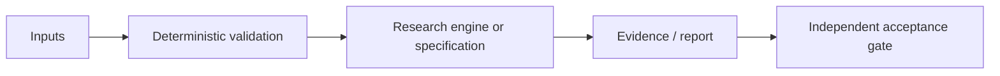

# Complex Matrix / Q-CNO: научно-техническое досье V5

**Дата ревизии:** 24.10.2026. **Доказательный статус:** EXPERIMENTAL. **Репозиторий:** [Shtenco/synergy_complex_matrix_multiplication](https://github.com/Shtenco/synergy_complex_matrix_multiplication).

> Документационная оценка фактически обнаруженных файлов main. Не является отчётом о свежем запуске CI, независимом benchmark, готовности производства или научным доказательством результата.

## Исследовательская проблема и проектная цель

Структурированные операторы, FFT, low-rank и quantized dictionary.

## Математическое ядро

\[Y=XW,\qquad U=D_1 F^{-1} D_2 F,\quad \mathrm{PPL}=\exp(\mathrm{crossentropy}).\]

Математическая запись отделяет модель от операционно подтверждённого результата. Любые заявленные преимущества должны быть перепроверены на сопоставимых baseline и зафиксированных входных данных.

## Архитектурная карта

Это концептуальный поток: стрелки не обозначают уже развернутую связь с другими сервисами.

## Артефакты исходного дерева

- [`src/qcno_exact_operator_benchmark.py`](../src/qcno_exact_operator_benchmark.py)
- [`docs/qcno_v31_common_eval_final.txt`](../docs/qcno_v31_common_eval_final.txt)
- [`figures_svg/v10_verified_quality_frontier.svg`](../figures_svg/v10_verified_quality_frontier.svg)

## Критерии приемки и фальсификация

Измерять same-operator latency, memory, batch/device, student PPL и сопоставимый dense baseline.

Обязательные поля для подтверждённого результата: commit SHA, environment, invocation, dataset manifest, raw measurements, baseline, uncertainty, adversarial/negative controls и точная область действия утверждения.

## Ограничения и угрозы

Большой kernel speedup не означает ускорение end-to-end LLM или квантовое преимущество; PPL ratio оценивается отдельно.

Нельзя превращать архитектурную идею, гипотезу, simulated return либо workflow definition в статус DEPLOYED или GREEN без наблюдаемого и проверяемого evidence.

## Следующая итерация

1. Привязать каждый claim к конкретному source/тесту/артефакту.
2. Описать один negative control и минимальный воспроизводимый acceptance-gate.
3. Зафиксировать честный maturity level, а не расширять рекламные формулировки.
4. Сохранять прежние README, историю и исследовательские исходники.

**Эталоны оформления:** [REVERSE-EXP](https://github.com/Shtenco/dlp_solver), [SYNERGY SYSTEM](https://github.com/Shtenco/synergy_system).
